# Pyrive OSG

Pyrive 的轻量级 C++ / OpenSceneGraph 功能扩展库，命名空间为 **`Pyrive::OsgKit`**。

公共 CMake 目标为 `Pyrive::OsgKit`。头文件路径仍为 `<PereVia/OsgKit.h>`，库文件仍为 `PereViaOsg[d]`；宿主需使用新的命名空间并重新编译，以匹配新的 DLL 导出符号。
公共头文件含 UTF-8 中文注释，MSVC 宿主应启用 `/utf-8` 编译选项，与库项目保持一致。

将库接入已有的 OSG 场景，通过配置创建发射物，检测指定目标，命中后生成闪光、火球、火花和烟雾。宿主继续管理窗口、相机和渲染循环。

## 当前功能

- `TerrainBuilder::build(options)`：由规则高程栅格创建地形，返回 `osg::ref_ptr<osg::Node>`；可选完整网格、约 5% 面数简化网格和两图面片三级 LOD。
- `IslandBuilder::build(options)`：输入海岸轮廓，统一返回 `osg::ref_ptr<osg::Node>`；可选三级 LOD：完整网格、约 5% 面数的简化网格和两图面片。
- `Runtime`：借用宿主的 viewer、camera、root，自动挂载和移除 `PereViaRoot`。
- `createProjectile(runtime, options)`：显式指定场景归属，配置位置、方向、速度、重力和碰撞目标。
- 命中效果：闪光、火球、火花及上升消散的烟雾，各层效果可配置，结束后自动回收。
- 测试用匀速立方体：通过 `runtime.createURMCube(options)` 创建。
- 更新与时间：使用 OSG UpdateTraversal 和帧仿真时间，不需要额外定时器。

## 效果预览

以下为测试宿主的实际渲染截图：

500×500 高程地形（F5 默认）：LOD0 为 250,000 个顶点、498,002 个三角面，LOD1 为 24,900 面（约 5%），LOD2 为 2 个可见面。模拟高程包含山峰、山谷和多尺度起伏，创建代码见 [TerrainExample.h](tests/TerrainExample.h)。按 `0` 自动切换，按 `1/2/3` 强制查看各级。

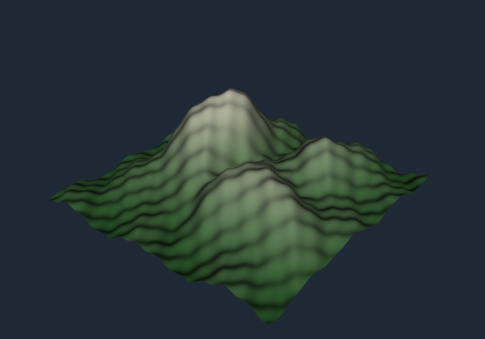

| 地形 LOD0：完整网格 | 地形 LOD1：约 5% 面数 |
| --- | --- |
| 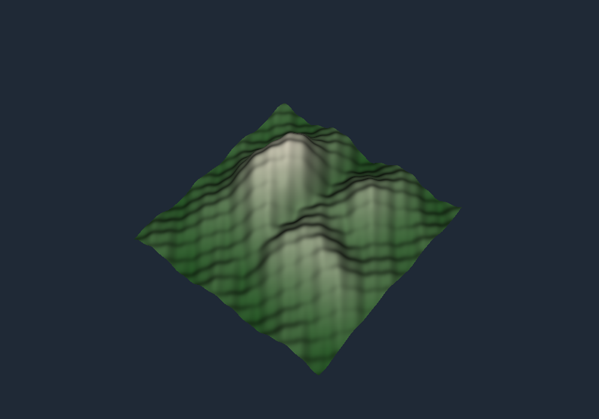 | 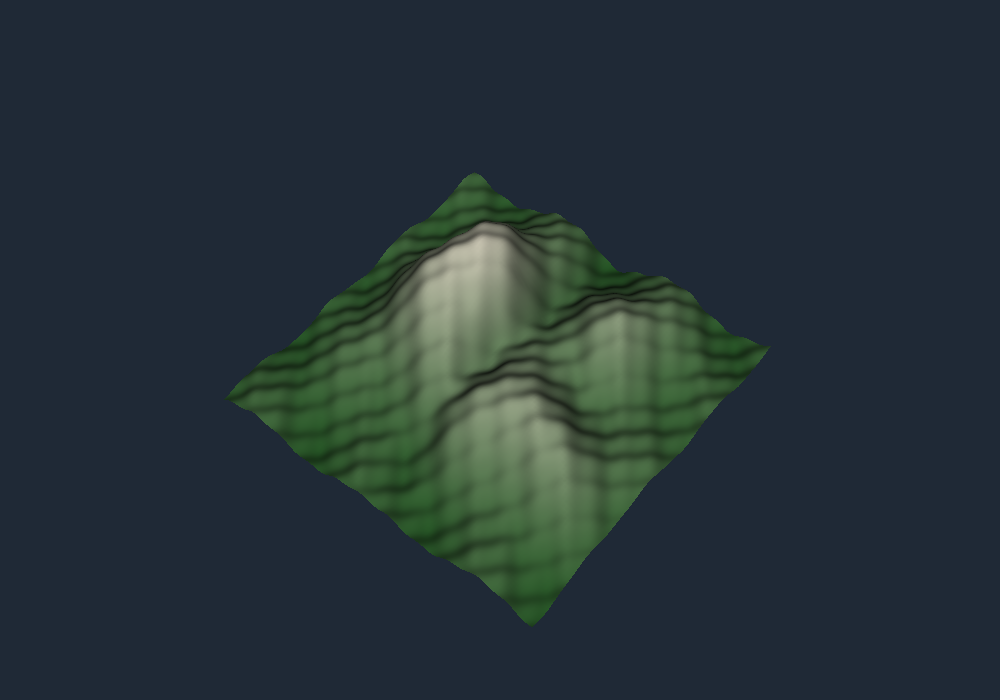 |
| LOD2：俯视面片 | LOD2：侧视面片 |
| 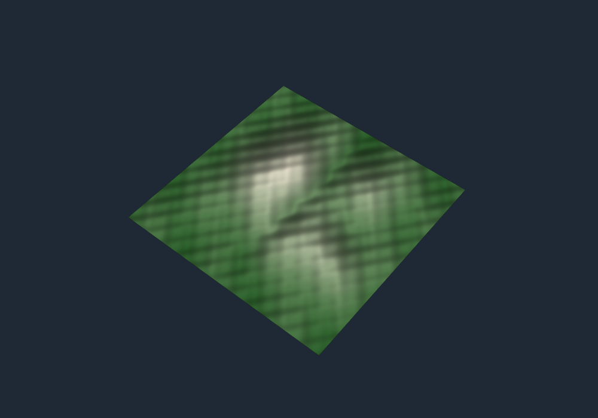 | 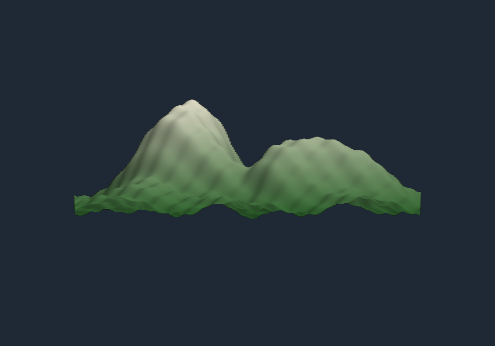 |

面片截图强制放大展示近似效果；自动模式仅在地形屏幕尺寸小于 60 像素时使用。开启 LOD 后各级预先生成并常驻内存，此例两张 256×256 RGBA 图像共 512 KiB（不含 mipmap），本机 Release 全级创建约 1 秒；LOD 主要降低远处绘制面数。

复杂岛屿（`--island-complex`）：80 点外岸、20＋16 点两个内环，4 次细分，完整模型 184,960 面；LOD1 为 9,247 面，LOD2 为 2 个可见三角面。海面由测试宿主添加，孔洞在地表、底面和俯视面片中均保持留空。

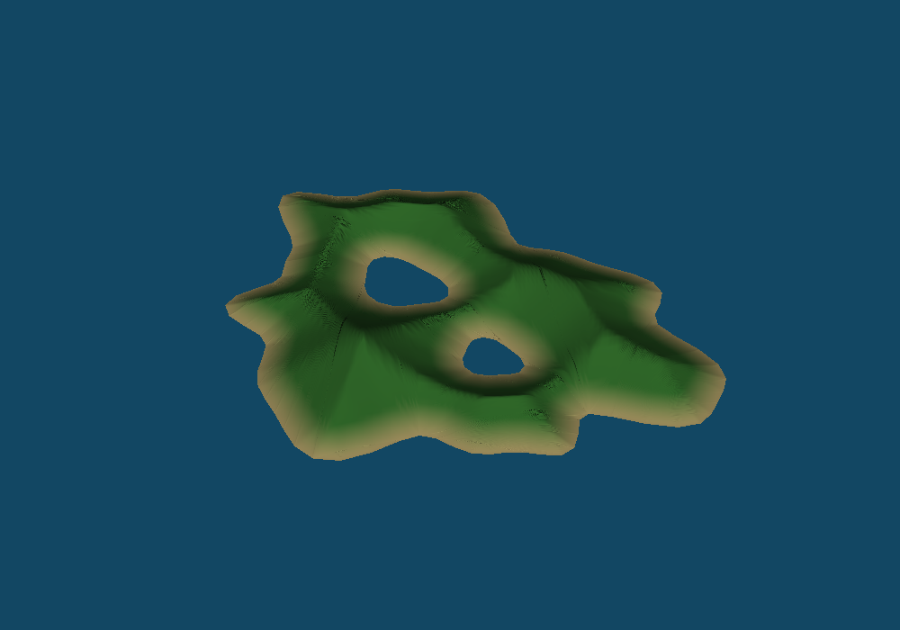

| 复杂岛屿简化网格 | 复杂岛屿俯视面片 |
| --- | --- |
| 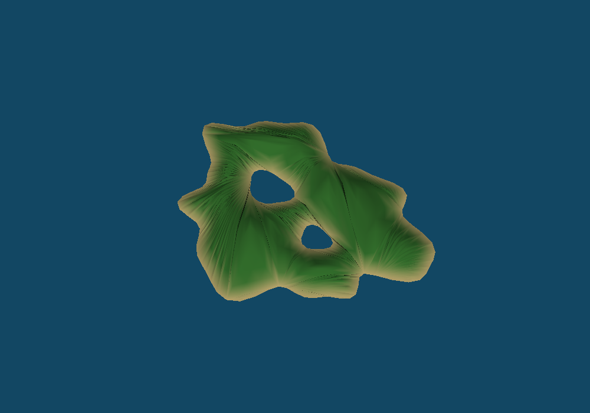 | 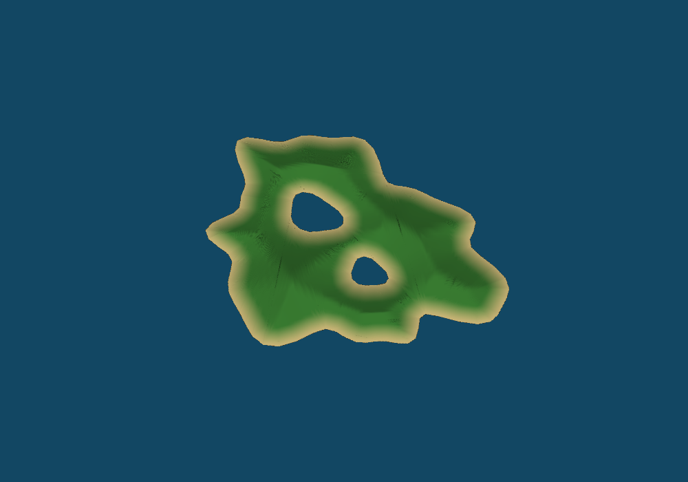 |

岛屿生成器（`--island`）：

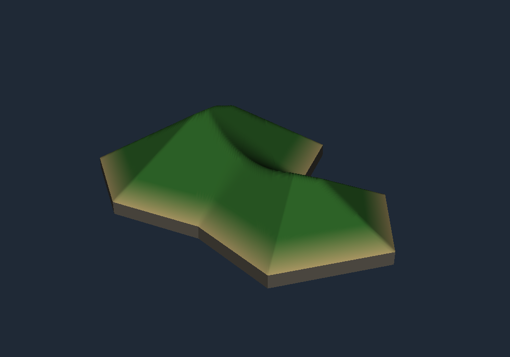

三级 LOD 的实际渲染（强制显示各级，面片截图故意放大以便观察近似效果）：

| LOD0：49,792 面 | LOD1：2,488 面 |
| --- | --- |
| 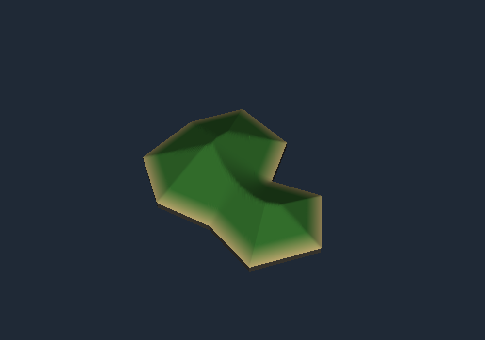 |  |
| LOD2：俯视面片，2 面 | LOD2：侧视面片，2 面 |
| 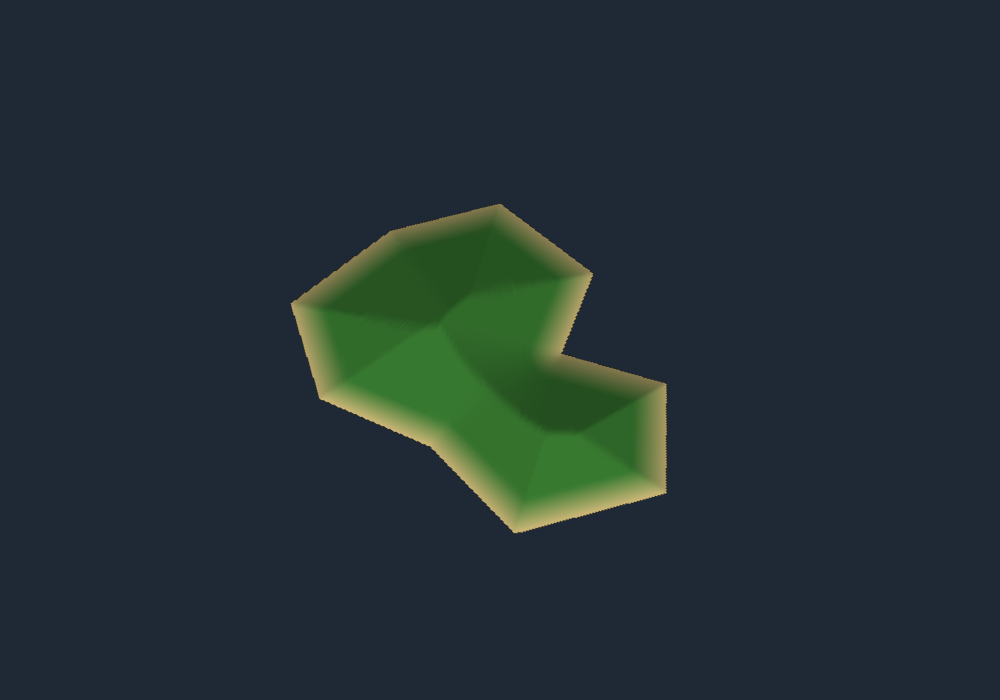 | 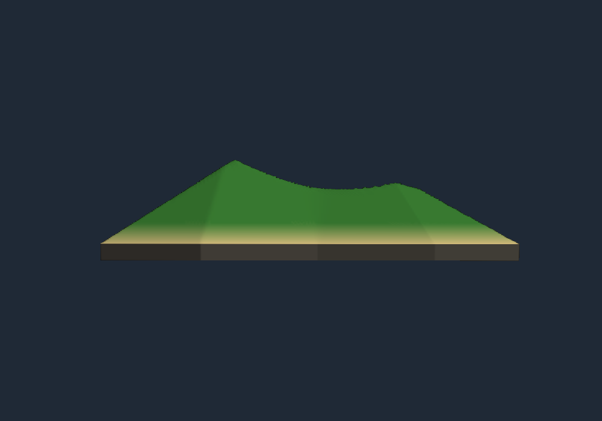 |

| 爆炸与火花 | 上升烟雾 |
| --- | --- |
|  | 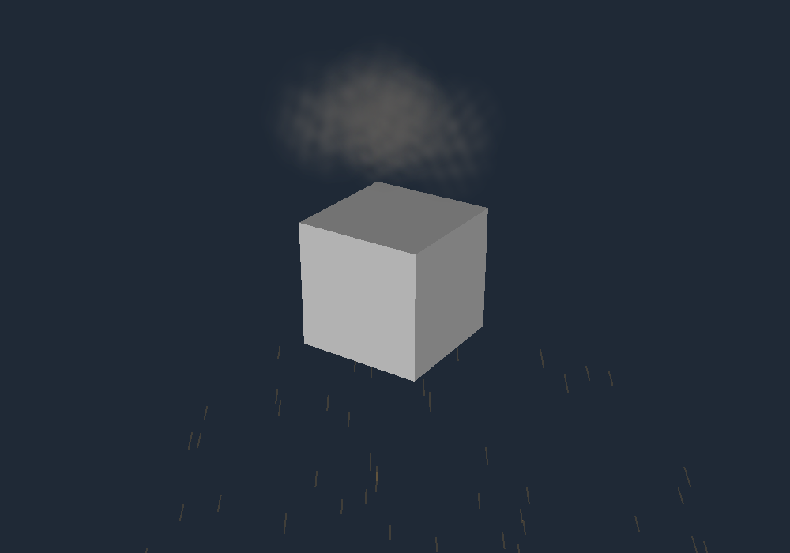 |

## 环境要求

| 项目 | 配置 |
| --- | --- |
| 操作系统 | Windows x64 |
| 编译器 | Visual Studio 2022 / MSVC v143 或 Visual Studio 2026 / MSVC v145（含预览版），安装“使用 C++ 的桌面开发”及 CMake 工具 |
| C++ 标准 | C++17 |
| OpenSceneGraph | 3.6.5，vcpkg 的 GL2 配置 |
| 构建配置 | Debug / Release，使用共享 CRT（/MDd / /MD） |

## 下载与构建

```powershell
git clone https://github.com/Pyrivelle/pyrive-osgkit.git
cd pyrive-osgkit
```

如果还没有 vcpkg，先安装一次：

```powershell
git clone https://github.com/microsoft/vcpkg.git C:\CProj\vcpkg
& C:\CProj\vcpkg\bootstrap-vcpkg.bat -disableMetrics
```

在仓库根目录运行：

```powershell
.\configure.ps1
.\build.ps1 -Configuration Release -RunTests
.\build.ps1 -Configuration Debug -RunTests
```

vcpkg 位于其他目录时，使用 `./configure.ps1 -VcpkgRoot 'D:\tools\vcpkg'`。

`configure.ps1` 自动识别本机 VS 2022 / 2026，包括 Insiders 预览版，并使用对应的 CMake 生成解决方案。已有兼容的 vcpkg x64-windows OSG 开发依赖（含 Debug / Release）时，可以复用安装目录，跳过依赖安装：

```powershell
.\configure.ps1 -InstalledDirectory C:\CProj\vcpkg\installed
```

**先运行 configure.ps1，再打开根目录的 PereVia.sln。** 生成的 `.vcxproj` 和 OSG 依赖位于忽略的 `build` 目录，不随源码提交。

解决方案只有两个项目：

| 项目 | 用途 |
| --- | --- |
| `PereViaOsg` | 动态库，生成 DLL、导入 LIB 和 SDK |
| `PereViaOsgTests` | 接入演示及自动测试，链接库的公开 API |

库可以单独构建，无需运行测试：

```powershell
.\build.ps1 -Configuration Release
```

在 VS 中将 `PereViaOsgTests` 设为启动项目，生成并按 F5，默认使用 `--terrain` 展示高程地形；设置 `--island-complex` 查看复杂岛屿，清空命令参数可查看原有发射物演示。也可以从命令行运行：

```powershell
.\build\Release\PereViaOsgTests.exe          # 交互窗口，Esc 退出
.\build\Release\PereViaOsgTests.exe --tests  # 无窗口自动测试
.\build\Release\PereViaOsgTests.exe --terrain # 500×500 高程地形，鼠标旋转/缩放
.\build\Release\PereViaOsgTests.exe --terrain-stats # 无窗口输出地形统计
.\build\Release\PereViaOsgTests.exe --terrain-smoke # 保存 build/terrain.ppm 后退出
.\build\Release\PereViaOsgTests.exe --terrain-lod-smoke # 保存地形完整、简化、俯视/侧视面片四张截图
.\build\Release\PereViaOsgTests.exe --smoke  # 约 6 秒的可视验证，保存阶段截图
.\build\Release\PereViaOsgTests.exe --island # 岛屿展示，鼠标旋转/缩放，Esc 退出
.\build\Release\PereViaOsgTests.exe --island-smoke # 渲染并保存 build/island.ppm 后退出
.\build\Release\PereViaOsgTests.exe --island-stats # 无窗口输出顶点、面数、面积、体积、数组内存及生成耗时
.\build\Release\PereViaOsgTests.exe --island-lod-smoke # 保存完整、简化、俯视面片和侧视面片的截图后退出
.\build\Release\PereViaOsgTests.exe --island-complex # 80 点外岸、两个内环水域与三级 LOD
.\build\Release\PereViaOsgTests.exe --island-complex-stats # 输出复杂岛屿统计
.\build\Release\PereViaOsgTests.exe --island-complex-lod-smoke # 保存复杂岛屿各级截图
```

## 最小接入

高程地形使用 `TerrainOptions`。高程数组按行排列，`elevations[r*columns+c]` 对应第 `r` 行、第 `c` 列；列沿 +X，行沿 +Y：

```cpp
#include <PereVia/OsgKit.h>

Pyrive::OsgKit::TerrainOptions terrainOptions;
terrainOptions.columns = 500;
terrainOptions.rows = 500;
terrainOptions.elevations = elevationData; // std::vector<double>，恰好 250000 个高程。
terrainOptions.origin.set(0, 0, 0);
terrainOptions.spacing.set(1, 1);
terrainOptions.elevationScale = 1;
terrainOptions.enableLOD = true;
terrainOptions.lod1TriangleRatio = 0.05;
osg::ref_ptr<osg::Node> terrain = Pyrive::OsgKit::TerrainBuilder::build(terrainOptions);
root->addChild(terrain.get());
```

500×500 指采样点数量；间距 1 时覆盖 499×499 场景单位。若覆盖范围需要正好 500×500，可把间距设为 `500.0/499`。规则网格每个单元连接两个三角形，不使用 Earcut；LOD0 保留输入高程，LOD1 重采样减面，LOD2 选一张面片。`enableLOD` 默认关闭，开启后默认按屏幕投影尺寸 ≥300／60～300／<60 像素切换。演示默认开启，按 `0/1/2/3` 查看自动／完整／简化／面片。地形接口和公式详见 [高程地形接入说明](docs/Integration.md#terrainbuilder高程地形)。

岛屿生成不需要 `Runtime`，只需传入一圈海岸线并挂到宿主场景：

```cpp
#include <PereVia/OsgKit.h>

Pyrive::OsgKit::IslandOptions options;
options.contour = {{-60, -25}, {-30, -45}, {5, -38}, {40, -45},
    {65, -10}, {45, 20}, {15, 10}, {5, 40}, {-35, 45}, {-55, 15}};
options.height = 25.0;
options.baseDepth = 5.0;
options.subdivisions = 5;
options.enableLOD = true;
options.lod1TriangleRatio = 0.05;
// 可选：options.holes = {{ /* 岛内水域边界点 */ }};
osg::ref_ptr<osg::Node> island = Pyrive::OsgKit::IslandBuilder::build(options);
root->addChild(island.get());
```

轮廓使用 XY 平面场景坐标，+Z 向上；顺/逆时针、可选首尾闭合均可，支持凹海湾。海岸位于 `seaLevel`，内部根据到岸线的距离升高，最高采样点为 `seaLevel + height`，底面为 `seaLevel - baseDepth`。相同参数生成相同网格。详见 [岛屿参数](docs/Integration.md#islandbuilder岛屿生成)。

`enableLOD` 默认关闭，此时实际节点为 `osg::Geode`；开启后为 `osg::LOD`。两种情况均用 Node 接收，原先显式接收 Geode 的宿主代码需相应修改并重新编译。演示默认开启 LOD：按 `0` 自动选择，`1` 强制完整网格，`2` 强制简化网格，`3` 强制面片；滚轮缩放可查看自动切换。`holes` 支持多个严格位于外环内部、互不接触且不嵌套的孔洞；地表、底面及俯视纹理均留空，内岸具有侧壁。水面由宿主添加。

下面的 `viewer`、`camera`、`root` 和 `shipGroup` 都是宿主已创建的 OSG 对象指针，`root` 已挂入宿主场景：

```cpp
#include <PereVia/OsgKit.h>

// 在宿主渲染循环之前初始化一次。
Pyrive::OsgKit::Runtime runtime(viewer, camera, root);

Pyrive::OsgKit::ProjectileOptions shot;
shot.position.set(0, 0, 8);
shot.direction.set(0, 0, -1);
shot.speed = 1.0;
shot.gravityEnabled = true;
shot.gravity.set(0, 0, -9.81);
shot.collisionTargets = {shipGroup};
shot.explosion.radius = 2.0f;
shot.smoke.duration = 3.5;

auto projectile = Pyrive::OsgKit::createProjectile(runtime, shot);

while (!viewer->done()) {
    viewer->frame();
}
// runtime 析构时移除自己的场景子树，保留宿主原有内容。
```

完整可运行示例见 [tests/Main.cpp](tests/Main.cpp)，配置字段、坐标和生命周期说明见 [接入说明](docs/Integration.md)。F5 默认展示高程地形，直接运行程序且不传参数时展示原有发射物与命中效果。

## 目录

```text
include/PereVia/       对外头文件与 DLL 导入导出宏
src/                  高程地形、岛屿、Runtime、发射物及效果的内部实现
tests/                接入演示和自动验证
cmake/                OSG 依赖与 SDK 的 CMake 接入配置
scripts/              解决方案整理、构建后打包
docs/                 接入说明和效果预览
PereVia.sln           唯一的 Visual Studio 解决方案
configure.ps1         安装依赖并生成工程
build.ps1             构建库或运行测试
```

## SDK 输出

构建 `PereViaOsg` 后自动输出到 `dist`：

```text
dist/include/PereVia/     公共头文件
dist/bin/Debug|Release/   DLL、运行依赖，及可用的 PDB
dist/lib/Debug|Release/   导入 LIB
dist/lib/cmake/           CMake find_package 配置
dist/docs/               接入说明与效果预览
dist/licenses/           依赖许可证
dist/LICENSE             本项目 MIT 许可证
```

宿主添加 `dist/include`，链接对应配置的 `PereViaOsg[d].lib`，部署对应 DLL 和运行依赖，并使用匹配的 OSG 开发环境。CMake 宿主也可以通过 `find_package(PereViaOsg CONFIG REQUIRED)` 链接 `Pyrive::OsgKit`。

## 当前边界

- 使用同一个 SingleThreaded 场景线程创建对象、更新场景及销毁 Runtime。
- 发射物位置、方向和重力采用 PereViaRoot 局部坐标；碰撞只检查配置中的已加载目标子树。
- 当前碰撞检测使用中心运动路径与模型表面求交，球体半径仅控制外观。
- 目标由宿主持有，库只保存弱引用；发射物返回 `osg::ref_ptr`，可在自动回收后读取最后位置。
- 爆炸和烟雾是精灵视觉效果，暂不模拟体积烟雾或粒子碰撞。

Debug、Release 的自动测试覆盖 500×500 高程逐点映射、地形法线/UV/绕序、非法高程输入，以及岛屿凹轮廓/孔洞/LOD、封闭网格、法线、高度与参数校验，另有场景挂载与清理、运动、目标选择、变换坐标、碰撞及效果生命周期验证。`build`、`dist`、下载的依赖和 VS 本地缓存不纳入版本控制。

## 许可证

项目沿用仓库的 [MIT License](LICENSE)。OpenSceneGraph、OpenThreads 和其他运行依赖保留各自许可证；构建 SDK 时在 `dist/licenses` 中附带对应的 vcpkg 许可文件。

岛屿初始三角剖分使用内置的 [mapbox/earcut.hpp](https://github.com/mapbox/earcut.hpp)（ISC）。固定源码版本与许可证见 [依赖说明](third_party/earcut/README.md)，SDK 中附带 `dist/licenses/earcut.txt`；无需额外链接库。
