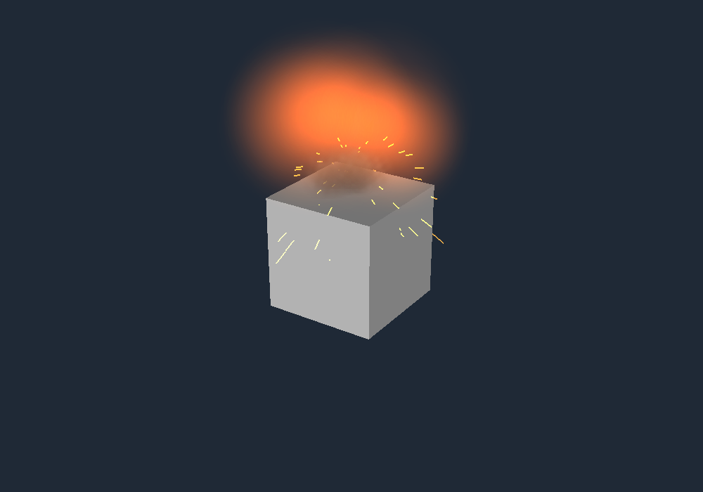

# PereVia OSG

Perevia 的轻量级 C++ / OpenSceneGraph 功能扩展库，命名空间为 **`PereVia::OsgKit`**。

将库接入已有的 OSG 场景，通过配置创建发射物，检测指定目标，命中后生成闪光、火球、火花和烟雾。宿主继续管理窗口、相机和渲染循环。

## 当前功能

- `Runtime`：借用宿主的 viewer、camera、root，自动挂载和移除 `PereViaRoot`。
- `createProjectile(runtime, options)`：显式指定场景归属，配置位置、方向、速度、重力和碰撞目标。
- 命中效果：闪光、火球、火花及上升消散的烟雾，各层效果可配置，结束后自动回收。
- 测试用匀速立方体：通过 `runtime.createURMCube(options)` 创建。
- 更新与时间：使用 OSG UpdateTraversal 和帧仿真时间，不需要额外定时器。

## 效果预览

以下为测试宿主的实际渲染截图：

| 爆炸与火花 | 上升烟雾 |
| --- | --- |
|  |  |

## 环境要求

| 项目 | 配置 |
| --- | --- |
| 操作系统 | Windows x64 |
| 编译器 | Visual Studio 2022 / MSVC v143，安装“使用 C++ 的桌面开发”及 CMake 工具 |
| C++ 标准 | C++17 |
| OpenSceneGraph | 3.6.5，vcpkg 的 GL2 配置 |
| 构建配置 | Debug / Release，使用共享 CRT（/MDd / /MD） |

## 下载与构建

```powershell
git clone https://github.com/ZhulX-UR/perevia-osgkit.git
cd perevia-osgkit
```

如果还没有 vcpkg，先安装一次：

```powershell
git clone https://github.com/microsoft/vcpkg.git C:\CProj\vcpkg
& C:\CProj\vcpkg\bootstrap-vcpkg.bat -disableMetrics
```

在仓库根目录运行：

```powershell
.\configure.ps1
.\build.ps1 -Configuration Release -RunTests
.\build.ps1 -Configuration Debug -RunTests
```

vcpkg 位于其他目录时，使用 `./configure.ps1 -VcpkgRoot 'D:\tools\vcpkg'`。

**先运行 configure.ps1，再打开根目录的 PereVia.sln。** 生成的 `.vcxproj` 和 OSG 依赖位于忽略的 `build` 目录，不随源码提交。

解决方案只有两个项目：

| 项目 | 用途 |
| --- | --- |
| `PereViaOsg` | 动态库，生成 DLL、导入 LIB 和 SDK |
| `PereViaOsgTests` | 接入演示及自动测试，链接库的公开 API |

库可以单独构建，无需运行测试：

```powershell
.\build.ps1 -Configuration Release
```

在 VS 中将 `PereViaOsgTests` 设为启动项目，生成并按 F5；也可以从命令行运行：

```powershell
.\build\Release\PereViaOsgTests.exe          # 交互窗口，Esc 退出
.\build\Release\PereViaOsgTests.exe --tests  # 无窗口自动测试
.\build\Release\PereViaOsgTests.exe --smoke  # 约 6 秒的可视验证，保存阶段截图
```

## 最小接入

下面的 `viewer`、`camera`、`root` 和 `shipGroup` 都是宿主已创建的 OSG 对象指针，`root` 已挂入宿主场景：

```cpp
#include <PereVia/OsgKit.h>

// 在宿主渲染循环之前初始化一次。
PereVia::OsgKit::Runtime runtime(viewer, camera, root);

PereVia::OsgKit::ProjectileOptions shot;
shot.position.set(0, 0, 8);
shot.direction.set(0, 0, -1);
shot.speed = 1.0;
shot.gravityEnabled = true;
shot.gravity.set(0, 0, -9.81);
shot.collisionTargets = {shipGroup};
shot.explosion.radius = 2.0f;
shot.smoke.duration = 3.5;

auto projectile = PereVia::OsgKit::createProjectile(runtime, shot);

while (!viewer->done()) {
    viewer->frame();
}
// runtime 析构时移除自己的场景子树，保留宿主原有内容。
```

完整可运行示例见 [tests/Main.cpp](tests/Main.cpp)，配置字段、坐标和生命周期说明见 [接入说明](docs/Integration.md)。Main 中的匀速立方体示例目前保留为注释，默认展示发射物与命中效果。

## 目录

```text
include/PereVia/       对外头文件与 DLL 导入导出宏
src/                  Runtime、发射物及效果的内部实现
tests/                接入演示和自动验证
cmake/                OSG 依赖与 SDK 的 CMake 接入配置
scripts/              解决方案整理、构建后打包
docs/                 接入说明和效果预览
PereVia.sln           唯一的 Visual Studio 解决方案
configure.ps1         安装依赖并生成工程
build.ps1             构建库或运行测试
```

## SDK 输出

构建 `PereViaOsg` 后自动输出到 `dist`：

```text
dist/include/PereVia/     公共头文件
dist/bin/Debug|Release/   DLL、运行依赖，及可用的 PDB
dist/lib/Debug|Release/   导入 LIB
dist/lib/cmake/           CMake find_package 配置
dist/docs/               接入说明与效果预览
dist/licenses/           依赖许可证
dist/LICENSE             本项目 MIT 许可证
```

宿主添加 `dist/include`，链接对应配置的 `PereViaOsg[d].lib`，部署对应 DLL 和运行依赖，并使用匹配的 OSG 开发环境。CMake 宿主也可以通过 `find_package(PereViaOsg CONFIG REQUIRED)` 链接 `PereVia::OsgKit`。

## 当前边界

- 使用同一个 SingleThreaded 场景线程创建对象、更新场景及销毁 Runtime。
- 发射物位置、方向和重力采用 PereViaRoot 局部坐标；碰撞只检查配置中的已加载目标子树。
- 当前碰撞检测使用中心运动路径与模型表面求交，球体半径仅控制外观。
- 目标由宿主持有，库只保存弱引用；发射物返回 `osg::ref_ptr`，可在自动回收后读取最后位置。
- 爆炸和烟雾是精灵视觉效果，暂不模拟体积烟雾或粒子碰撞。

Debug、Release 的自动测试覆盖场景挂载与清理、运动、目标选择、变换坐标、碰撞及效果生命周期。`build`、`dist`、下载的依赖和 VS 本地缓存不纳入版本控制。

## 许可证

项目沿用仓库的 [MIT License](LICENSE)。OpenSceneGraph、OpenThreads 和其他运行依赖保留各自许可证；构建 SDK 时在 `dist/licenses` 中附带对应的 vcpkg 许可文件。
